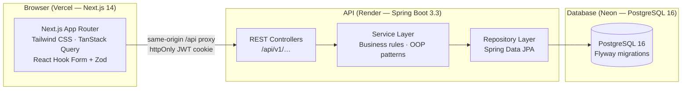

# YEP - Youth Digital Empowerment and Virtual Exchange Platform

A full-stack platform for running **Level One** (large-group online learning) and **Level Two**
(small-team impact projects) virtual exchanges for young people in Uganda and East Africa. The
platform covers accounts, activities, sessions, attendance, materials, discussions, assessments,
teams, impact projects, mentoring, partner opportunities, support offers, notifications and
publicly verifiable certificates.

| Layer | Stack |
|---|---|
| Backend | Java 17, Spring Boot 3.3, Spring Security (JWT), JPA/Hibernate, Flyway, PostgreSQL/Neon, OpenPDF + ZXing, Maven, JUnit 5 |
| Frontend | Next.js 14 App Router, TypeScript, Tailwind CSS, TanStack Query, React Hook Form + Zod |
| Docs | [UML class diagram](docs/UML_CLASS_DIAGRAM.md), [ER diagram](docs/ER_DIAGRAM.md), [deployment guide](docs/DEPLOYMENT.md) |

## Repository layout

```
.
├── YEP_Full_Stack_AI_Build_Prompt.docx   # original specification
├── backend/                              # Spring Boot API ("com.yep")
│   ├── src/main/java/com/yep/
│   │   ├── config/       # SecurityConfig, DataInitializer
│   │   ├── domain/       # users, activities, learning, projects, partners, notifications
│   │   ├── dto/          # Auth, Learning, Project, Partner, Admin records
│   │   ├── repository/   # Spring Data JPA
│   │   ├── security/     # JWT, rate limiting, REST auth handlers
│   │   ├── service/      # business rules and domain services
│   │   └── web/          # REST controllers under /api/v1
│   ├── src/main/resources/
│   │   ├── application.yml / application-prod.yml
│   │   └── db/migration/ # V1__core_from_er.sql, V2__additions.sql, V3__indexes.sql
│   ├── src/test/java/com/yep/ # Auth, learning, project and partner flow tests
│   └── Dockerfile
├── frontend/                             # Next.js client
│   └── src/
│       ├── app/        # /, login, register, dashboard, exchanges, teams, projects,
│       │               # assessments, notifications, opportunities, partner, admin,
│       │               # certificates, messages redirect, offline, /api proxy
│       ├── components/ # Navbar, RequireAuth, Providers, ui/*
│       └── lib/        # api client, auth context, DTO types, zod schemas, formatters
└── docs/               # UML, ER and deployment documentation
```

## Features

- **Accounts and roles** - participants, facilitators, mentors, partners and administrators.
  Participants register as `ACTIVE`; facilitators, mentors and partners register as `PENDING`
  until an administrator approves them. JWTs expire after 8 hours by default.
- **Authentication** - BCrypt password hashes, JWT in the response body and an httpOnly
  `yep_token` cookie, login rate limiting (10 attempts/minute/IP+email), password reset tokens
  and password changes.
- **Activities** - Level One and Level Two activities, sessions, attendance, materials,
  discussion threads, assessment tasks, rosters and enrollment status management.
- **Enrollment** - capacity-aware self-enrollment, waitlisting and automatic promotion from the
  waitlist when an enrolled participant cancels. Level Two requires `levelTwoEligible`.
- **Teams** - Level Two team creation, self-join, add/remove members, mentor assignment and
  locking once the minimum team size is reached.
- **Impact projects** - draft, submit, mentor review, changes requested, approval, completion and
  public showcase; milestones, AI-usage declarations and support visibility.
- **Assessments** - facilitators and administrators create tasks, participants submit, staff grade,
  and participants see scores and feedback.
- **Certificates** - issued when assessment and attendance thresholds are met, with a public
  verification page and PDF download containing a QR code.
- **Partners** - verified partners publish opportunities, review expressions of interest, offer
  support to projects and track support offers.
- **Notifications** - in-app notifications with unread counts and mark-read/mark-all-read.
- **Administration** - dashboard, user approval/suspension/role switching, activity management,
  partner verification, audit logs and platform settings.
- **Frontend proxy** - the browser calls same-origin `/api/*`; Next.js forwards to the Spring API,
  avoiding CORS and keeping the JWT cookie on one origin.

## Quick start (local)

### 1. Database

Create a PostgreSQL database (local or Neon) and run the API. Flyway applies all three migrations
on boot; Hibernate runs with `ddl-auto: validate`.

```powershell
$env:DB_URL='jdbc:postgresql://localhost:5432/yep'
$env:DB_USER='yep'
$env:DB_PASSWORD='yep'
$env:ADMIN_EMAIL='admin@yep.local'
$env:ADMIN_PASSWORD='ChangeMe123!'
```

### 2. Backend

Maven is not on PATH in this workspace. If needed, download Maven to `%TEMP%` and use:

```powershell
& "$env:TEMP\apache-maven-3.9.9\bin\mvn.cmd" -B -f backend/pom.xml spring-boot:run
```

API base: `http://localhost:8080`; health: `http://localhost:8080/actuator/health`.

The first administrator is seeded only when the `users` table is empty and `ADMIN_EMAIL` and
`ADMIN_PASSWORD` are set. `ADMIN_NAME` is optional.

### 3. Frontend

```powershell
cd frontend
Copy-Item .env.example .env.local     # NEXT_PUBLIC_API_URL=http://localhost:8080
npm install
npm run dev                            # http://localhost:3000
```

### 4. Tests and quality gates

```powershell
# Backend: 20 integration/schema tests on in-memory H2
& "$env:TEMP\apache-maven-3.9.9\bin\mvn.cmd" -B -f backend/pom.xml test

# Backend: full verify
& "$env:TEMP\apache-maven-3.9.9\bin\mvn.cmd" -B -f backend/pom.xml verify

# Frontend
cd frontend
npm run typecheck
npm run build
```

## API map (v1)

All endpoints are under `/api/v1` unless noted. Errors use
`{ timestamp, status, error, code, message, path, fieldErrors }`.

| Area | Endpoints |
|---|---|
| Auth | `POST /auth/register`, `POST /auth/login`, `POST /auth/logout`, `POST /auth/forgot-password`, `POST /auth/reset-password`, `GET /auth/me`, `PUT /auth/me`, `PUT /auth/me/password`, `PUT /auth/me/consent` |
| Activities | `GET /activities`, `GET /activities/{id}`, `POST /activities/{id}/enroll`, `POST /activities/{id}/apply`, `POST /activities/{id}/complete`, `GET /me/enrollments`, `GET /enrollments/me`, `DELETE /enrollments/{id}`, `GET /me/results` |
| Exchanges (spec alias) | `GET /exchanges`, `GET /exchanges/{id}`, `POST /exchanges/{id}/enroll` (same handlers as activities) |
| Users | `GET /users/{id}` (own profile, or any profile for an admin) |
| Facilitator activities | `GET /facilitator/activities`, `POST /activities`, `GET /facilitator/activities/{id}`, `PUT /activities/{id}`, `PUT /activities/{id}/status`, `GET /activities/{id}/participants`, `PUT /enrollments/{id}/decision` |
| Sessions | `GET/POST /activities/{id}/sessions`, `PUT/DELETE /sessions/{id}`, `PUT /sessions/{id}/status`, `POST /sessions/{id}/check-in`, `GET/PUT /sessions/{id}/attendance`, `GET /attendance/me` |
| Materials | `GET/POST /activities/{id}/materials`, `PUT/DELETE /materials/{id}` |
| Discussions | `GET/POST /activities/{id}/threads`, `GET/POST /threads/{id}/posts`, `PUT /posts/{id}`, `POST /posts/{id}/flag`, `PUT /facilitator/posts/{id}/moderate`, `GET /facilitator/activities/{id}/flagged-posts` |
| Assessments | `GET/POST /activities/{id}/tasks`, `PUT /tasks/{id}`, `POST /tasks/{id}/submit`, `GET /tasks/{id}/submissions`, `GET /assessments/me`, `PUT /assessments/{id}/grade` |
| Progress | `GET /progress/me`, `GET /activities/{id}/progress`, `GET /facilitator/activities/{id}/progress/{youthId}` |
| Certificates | `GET /me/certificates`, `GET /certificates/me`, `GET /certificates/{id}/pdf`, `POST /activities/{id}/certificates/{youthId}`, `PUT /admin/certificates/{id}/revoke`, `GET /public/certificates/{number}`, `GET /public/certificates/{number}/pdf`, `GET /certificates/verify/{code}` |
| Teams | `POST /teams`, `GET /teams/my`, `GET /teams/mentored`, `GET /teams/activity/{activityId}`, `GET /teams/{id}`, `POST /teams/{id}/members`, `DELETE /teams/{id}/members/{youthId}`, `PUT /teams/{id}/mentor`, `PUT /teams/{id}/lock` |
| Projects | `POST /projects`, `GET /projects/my`, `GET /projects/mentored`, `GET /projects/showcase`, `GET /projects/team/{teamId}`, `GET/PUT /projects/{id}`, `POST /projects/{id}/milestones`, `PUT /milestones/{id}`, `POST /projects/{id}/submit`, `POST/GET /projects/{id}/reviews`, `PUT /projects/{id}/support-visibility`, `POST /projects/{id}/complete` |
| Support | `GET/POST /projects/{id}/supports`, `PUT /supports/{id}/respond` |
| Opportunities | `GET /public/opportunities`, `GET /opportunities/my-interests`, `POST /opportunities/{id}/interest`, `GET/POST /partner/opportunities`, `PUT /partner/opportunities/{id}`, `PUT /partner/opportunities/{id}/close`, `GET /partner/opportunities/{id}/interests`, `GET /partner/supports` |
| Notifications | `GET /notifications`, `GET /notifications/unread-count`, `PUT /notifications/{id}/read`, `PUT /notifications/read-all` |
| Messages | `GET /messages`, `GET /messages/unread-count`, `POST /messages`, `PUT /messages/{id}/read`, `PUT /messages/read-all` (in-app, backed by notifications) |
| Public | `GET /public/settings`, `GET /public/opportunities`, `GET /public/projects/showcase`, `GET /public/certificates/{number}` |
| Admin users | `GET/POST /admin/users`, `GET /admin/users/{id}`, `PUT /admin/users/{id}/status`, `PUT /admin/users/{id}/approve`, `PUT /admin/users/{id}/role` |
| Admin platform | `GET /admin/dashboard`, `GET /admin/moderation`, `GET /admin/audit-logs`, `GET /admin/settings`, `PUT /admin/settings/{key}`, `GET /admin/partners`, `PUT /admin/partners/{id}/verification`, `PUT /admin/posts/{id}/hide`, `GET /admin/reports/{type}` |

## Business rules worth knowing

- Registration validates participant age (18-35) and country against the configured country list.
- Only `FACILITATOR` and `MENTOR` accounts can switch roles, and only when no activities, teams or
  reviews depend on the account.
- A Level Two activity requires a participant to have `levelTwoEligible=true`.
- Certificates require the activity's pass mark and minimum attendance percentage. Issuing a Level
  One certificate sets `levelTwoEligible=true`.
- Project submission requires at least two milestones, the minimum team size and an AI-usage
  declaration when AI was used.
- Only the assigned mentor can review a project; only team managers can complete an approved project.
- Verified partners can publish opportunities and offer support; support offers are only accepted
  for projects that are open for support and approved/completed.
- Activity discussions and notifications replace the old direct-messaging feature.

## OOP in the codebase

See [docs/UML_CLASS_DIAGRAM.md](docs/UML_CLASS_DIAGRAM.md) for the full diagram and mapping table.

- **Encapsulation** - entities keep private state and expose intent-revealing operations such as
  `register()`, `login()`, `enroll()`, `markRead()`, `evaluate()` and `submit()`.
- **Inheritance** - `User` is a JOINED hierarchy (`YouthParticipant`, `Facilitator`, `Mentor`,
  `PartnerOrganisation`, `Administrator`); `LearningActivity` and `Notification` use SINGLE_TABLE
  inheritance.
- **Polymorphism** - `LearningActivity.getLevelFeatures()` and `supportsTeamFormation()`;
  `Notification.send()` and `getType()`; `User.register()` applies role-specific status policy.
- **Abstraction** - services depend on repositories and abstract roots; controllers expose DTO
  records rather than entities.

## Deployment

Neon (PostgreSQL) -> Render (Dockerised API, Flyway on boot) -> Vercel (Next.js). Full steps,
environment variables, health checks and troubleshooting: [docs/DEPLOYMENT.md](docs/DEPLOYMENT.md).

## Licence / contact

Built for the YEP programme. No data is sold or shared with advertisers; only the fields needed to
run the programme are stored.


---

## Architecture overview



---

## Demo accounts

All demo accounts use password **`Demo1234!`**. Enable them by setting `SPRING_PROFILES_ACTIVE=demo`.

| Email | Role | Notes |
|---|---|---|
| `facilitator@yep.demo` | FACILITATOR | Owns 2 Level One + 1 Level Two demo activities |
| `mentor@yep.demo` | MENTOR | Assigned to the demo team |
| `alice@yep.demo` | PARTICIPANT | Uganda, level-two eligible, team LEADER |
| `bob@yep.demo` | PARTICIPANT | Kenya, level-two eligible, team member |
| `carol@yep.demo` | PARTICIPANT | Tanzania, enrolled in Level One |
| `david@yep.demo` | PARTICIPANT | Rwanda, enrolled in Level One |
| `eve@yep.demo` | PARTICIPANT | Uganda, enrolled in Level One |
| `frank@yep.demo` | PARTICIPANT | Kenya, enrolled in Level One |
| `university@yep.demo` | PARTNER | Makerere University (verified) |
| `employer@yep.demo` | PARTNER | TechHub EA (verified) |

The first administrator is created from `ADMIN_EMAIL` / `ADMIN_PASSWORD` on first boot (for example
`admin@yep.demo` when the deployment sets those values); it is not a fixed seeded account.

---

## Deployment order

1. **Neon** – create a PostgreSQL 16 project, copy the connection string.
2. **Render** – create a new Web Service from the `backend/` directory (or Docker image).
   Set the environment variables listed below. Flyway runs the three migrations on first boot.
3. **Vercel** – import the `frontend/` directory. Set `BACKEND_URL` and `NEXT_PUBLIC_APP_URL`.

### Render environment variables

| Variable | Required | Description |
|---|---|---|
| `DB_URL` | ✅ | Neon pooled connection string (`jdbc:postgresql://…/neon?sslmode=require`) |
| `DB_DIRECT_URL` | ✅ | Neon direct (non-pooled) URL — used by Flyway to avoid PgBouncer issues |
| `DB_USER` | ✅ | Neon database user |
| `DB_PASSWORD` | ✅ | Neon database password |
| `JWT_SECRET` | ✅ | Random ≥ 64 chars (`openssl rand -base64 64`) |
| `FRONTEND_URL` | ✅ | Vercel deployment URL (e.g. `https://yep.vercel.app`) |
| `ALLOWED_ORIGINS` | ✅ | Same as `FRONTEND_URL` |
| `SPRING_PROFILES_ACTIVE` | ✅ | `prod` (or `prod,demo` to seed demo data) |
| `MAIL_HOST` | Optional | SMTP host for email notifications |
| `MAIL_PORT` | Optional | SMTP port (default 587) |
| `MAIL_USER` | Optional | SMTP username |
| `MAIL_PASSWORD` | Optional | SMTP password |
| `MAIL_FROM` | Optional | Sender address (e.g. `noreply@yep.org`) |
| `AT_USERNAME` | Optional | Africa's Talking username for SMS |
| `AT_API_KEY` | Optional | Africa's Talking API key for SMS |
| `JWT_EXPIRY_HOURS` | Optional | JWT lifetime in hours (default 8) |

### Vercel environment variables

| Variable | Required | Description |
|---|---|---|
| `BACKEND_URL` | ✅ | Render service URL (e.g. `https://yep-api.onrender.com`) |
| `NEXT_PUBLIC_APP_URL` | ✅ | Vercel deployment URL |

---

## Database design note — JOINED inheritance

The five profile subtypes (`youth_participant`, `facilitator`, `mentor`, `administrator`,
`partner_organisation`) use **JPA JOINED inheritance**. This means:

- `users` holds the shared columns (`user_id`, `name`, `email`, `password_hash`, `status`, `role`, …).
- Each profile table holds only its own columns (`youth_participant.age`, `facilitator.specialisation`, …).
- The PK of each profile table (`youth_id`, `facilitator_id`, etc.) is **also the FK** to `users.user_id`.
  There is **no second** `user_id` column in the profile tables.
- Hibernate generates a JOIN query when loading a subtype.

---

## Limitations

| Limitation | Reason |
|---|---|
| Email delivery requires SMTP configuration | No bundled email server; configure SendGrid/Mailgun via env vars |
| SMS requires Africa's Talking credentials | Sandbox mode logs SMS to stdout without delivery |
| Video hosting not provided | Session `meetingLink` stores a third-party URL (Meet/Zoom/Jitsi) |
| Render free-tier cold start (30–60 s) | The `ServerWakingBanner` retries and shows a friendly message |
| PDF certificate storage | PDFs are generated and streamed on demand; not stored in cloud storage |
| No real-time WebSocket | Notifications poll `/notifications/unread-count` every 60 s |

---

## Admin and reports endpoints (added in Phase 6)

| Endpoint | Description |
|---|---|
| `PUT /admin/posts/{id}/hide` | Hide or unhide a discussion post (moderation) |
| `GET /admin/reports/{type}` | JSON report (type: participants, enrollments, certificates, projects, opportunities) |
| `GET /admin/reports/{type}?format=csv` | CSV download of the same report |
