# YEP - Entity Relationship Diagram

Source of truth: Flyway migrations `V1__core_from_er.sql`, `V2__additions.sql`, `V3__indexes.sql`.

```mermaid
erDiagram
    users {
        BIGINT user_id PK
        VARCHAR name
        VARCHAR email UK
        VARCHAR password_hash
        VARCHAR status "PENDING|ACTIVE|SUSPENDED"
        VARCHAR role "PARTICIPANT|FACILITATOR|MENTOR|ADMIN|PARTNER"
        VARCHAR phone
        TIMESTAMPTZ created_at
        TIMESTAMPTZ last_login_at
    }

    youth_participant {
        BIGINT youth_id PK,FK
        INTEGER age
        VARCHAR country
        VARCHAR digital_skills
        BOOLEAN level_two_eligible
        VARCHAR institution
        VARCHAR bio
        BOOLEAN share_profile_with_partners
        TIMESTAMPTZ consent_date
    }

    facilitator {
        BIGINT facilitator_id PK,FK
        VARCHAR specialisation
    }

    mentor {
        BIGINT mentor_id PK,FK
        VARCHAR organisation
        VARCHAR expertise
    }

    partner_organisation {
        BIGINT partner_id PK,FK
        VARCHAR organisation_name
        VARCHAR country
        VARCHAR organisation_type
        VARCHAR website
        VARCHAR description
        BOOLEAN verified
    }

    administrator {
        BIGINT admin_id PK,FK
        VARCHAR department
    }

    learning_activity {
        BIGINT activity_id PK
        BIGINT facilitator_id FK
        BIGINT partner_id FK
        VARCHAR title
        VARCHAR description
        DATE start_date
        DATE end_date
        VARCHAR category
        VARCHAR level "ONE|TWO"
        INTEGER capacity
        VARCHAR status "DRAFT|PUBLISHED|CLOSED|COMPLETED"
        INTEGER pass_mark
        INTEGER min_attendance_percent
        INTEGER min_team_size
        INTEGER max_team_size
    }

    enrollment {
        BIGINT enrollment_id PK
        BIGINT youth_id FK
        BIGINT activity_id FK
        TIMESTAMPTZ enrollment_date
        VARCHAR status "APPLIED|ENROLLED|REJECTED|WAITLISTED|COMPLETED|CANCELLED"
        TIMESTAMPTZ completed_at
    }

    virtual_session {
        BIGINT session_id PK
        BIGINT activity_id FK
        VARCHAR title
        TIMESTAMPTZ scheduled_start
        INTEGER duration_minutes
        VARCHAR meeting_link
        VARCHAR status "SCHEDULED|LIVE|COMPLETED|CANCELLED"
        BIGINT created_by FK
    }

    attendance {
        BIGINT attendance_id PK
        BIGINT session_id FK
        BIGINT youth_id FK
        VARCHAR status "PRESENT|ABSENT|EXCUSED"
        TIMESTAMPTZ marked_at
    }

    learning_material {
        BIGINT material_id PK
        BIGINT activity_id FK
        VARCHAR title
        VARCHAR material_type "VIDEO|PDF|LINK|SLIDES|TEXT"
        VARCHAR url
        VARCHAR description
        BIGINT uploaded_by FK
        TIMESTAMPTZ uploaded_at
        BOOLEAN published
    }

    discussion_thread {
        BIGINT thread_id PK
        BIGINT activity_id FK
        BIGINT team_id FK
        VARCHAR topic
        TIMESTAMPTZ created_at
    }

    discussion_post {
        BIGINT post_id PK
        BIGINT thread_id FK
        BIGINT user_id FK
        VARCHAR content
        TIMESTAMPTZ posted_at
        BOOLEAN flagged
        VARCHAR flag_reason
        BOOLEAN hidden
    }

    assessment_task {
        BIGINT task_id PK
        BIGINT activity_id FK
        VARCHAR title
        VARCHAR task_type "QUIZ|ASSIGNMENT"
        VARCHAR instructions
        JSONB questions
        INTEGER max_score
        TIMESTAMPTZ due_date
        BOOLEAN published
    }

    assessment {
        BIGINT assessment_id PK
        BIGINT activity_id FK
        BIGINT youth_id FK
        BIGINT task_id FK
        INTEGER score
        INTEGER max_score
        VARCHAR feedback
        TIMESTAMPTZ assessment_date
        JSONB answers
        VARCHAR submission_text
        VARCHAR status "SUBMITTED|GRADED"
        BIGINT graded_by FK
    }

    certificate {
        BIGINT certificate_id PK
        BIGINT youth_id FK
        BIGINT activity_id FK
        BIGINT project_id FK
        VARCHAR certificate_number UK
        DATE issue_date
        VARCHAR achievement
        BOOLEAN revoked
        TIMESTAMPTZ revoked_at
    }

    team {
        BIGINT team_id PK
        BIGINT mentor_id FK
        BIGINT activity_id FK
        BIGINT created_by FK
        VARCHAR team_name
        VARCHAR status "OPEN|FULL|LOCKED"
    }

    team_member {
        BIGINT member_id PK
        BIGINT team_id FK
        BIGINT youth_id FK
        VARCHAR role "LEADER|MEMBER"
    }

    impact_project {
        BIGINT project_id PK
        BIGINT team_id FK
        VARCHAR title
        VARCHAR description
        VARCHAR challenge_area
        VARCHAR status "DRAFT|SUBMITTED|UNDER_REVIEW|CHANGES_REQUESTED|APPROVED|COMPLETED"
        BOOLEAN ai_used
        VARCHAR ai_usage_declaration
        TIMESTAMPTZ submitted_at
        BOOLEAN open_for_support
    }

    milestone {
        BIGINT milestone_id PK
        BIGINT project_id FK
        VARCHAR title
        DATE due_date
        VARCHAR status "PENDING|IN_PROGRESS|DONE"
        TIMESTAMPTZ completed_at
    }

    project_review {
        BIGINT review_id PK
        BIGINT project_id FK
        BIGINT mentor_id FK
        VARCHAR decision "COMMENT|CHANGES_REQUESTED|APPROVED"
        VARCHAR feedback
        TIMESTAMPTZ created_at
    }

    project_support {
        BIGINT support_id PK
        BIGINT project_id FK
        BIGINT partner_id FK
        VARCHAR support_type "FUNDING|MENTORSHIP|RESOURCES|VISIBILITY"
        VARCHAR message
        VARCHAR status "OFFERED|ACCEPTED|DECLINED"
        TIMESTAMPTZ created_at
    }

    opportunity {
        BIGINT opportunity_id PK
        BIGINT partner_id FK
        VARCHAR title
        VARCHAR opportunity_type "JOB|INTERNSHIP|MENTORSHIP|SCHOLARSHIP|TRAINING"
        VARCHAR description
        VARCHAR location
        DATE deadline
        VARCHAR status "OPEN|CLOSED"
        TIMESTAMPTZ created_at
    }

    opportunity_interest {
        BIGINT interest_id PK
        BIGINT opportunity_id FK
        BIGINT youth_id FK
        VARCHAR message
        TIMESTAMPTZ created_at
    }

    notification {
        BIGINT notification_id PK
        BIGINT user_id FK
        VARCHAR message
        TIMESTAMPTZ date_sent
        VARCHAR type "IN_APP|EMAIL|SMS"
        BOOLEAN is_read
        VARCHAR link
    }

    password_reset_token {
        BIGINT token_id PK
        BIGINT user_id FK
        VARCHAR token_hash
        TIMESTAMPTZ expires_at
        BOOLEAN used
    }

    audit_log {
        BIGINT log_id PK
        BIGINT user_id FK
        VARCHAR action
        VARCHAR entity
        BIGINT entity_id
        VARCHAR details
        TIMESTAMPTZ created_at
    }

    system_setting {
        VARCHAR setting_key PK
        VARCHAR setting_value
        BIGINT updated_by FK
        TIMESTAMPTZ updated_at
    }

    users ||--o| youth_participant : "JOINED profile"
    users ||--o| facilitator : "JOINED profile"
    users ||--o| mentor : "JOINED profile"
    users ||--o| partner_organisation : "JOINED profile"
    users ||--o| administrator : "JOINED profile"

    facilitator ||--o{ learning_activity : "facilitates"
    partner_organisation ||--o{ learning_activity : "supports"
    youth_participant ||--o{ enrollment : "applies"
    learning_activity ||--o{ enrollment : "has"
    learning_activity ||--o{ virtual_session : "schedules"
    virtual_session ||--o{ attendance : "records"
    youth_participant ||--o{ attendance : "attends"
    learning_activity ||--o{ learning_material : "publishes"
    users ||--o{ learning_material : "uploads"
    learning_activity ||--o{ discussion_thread : "hosts"
    team ||--o{ discussion_thread : "team thread"
    discussion_thread ||--o{ discussion_post : "contains"
    users ||--o{ discussion_post : "posts"

    learning_activity ||--o{ assessment_task : "sets"
    assessment_task ||--o{ assessment : "submissions"
    youth_participant ||--o{ assessment : "submits"
    learning_activity ||--o{ assessment : "belongs to"
    users ||--o{ assessment : "grades"

    youth_participant ||--o{ certificate : "earns"
    learning_activity ||--o{ certificate : "activity certificate"
    impact_project ||--o{ certificate : "project certificate"

    learning_activity ||--o{ team : "forms"
    mentor ||--o{ team : "mentors"
    users ||--o{ team : "creates"
    team ||--o{ team_member : "has"
    youth_participant ||--o{ team_member : "joins"
    team ||--o| impact_project : "one project per team (UK)"
    impact_project ||--o{ milestone : "tracks"
    impact_project ||--o{ project_review : "reviewed"
    mentor ||--o{ project_review : "reviews"
    impact_project ||--o{ project_support : "receives"
    partner_organisation ||--o{ project_support : "offers"

    partner_organisation ||--o{ opportunity : "publishes"
    opportunity ||--o{ opportunity_interest : "interest"
    youth_participant ||--o{ opportunity_interest : "expresses"

    users ||--o{ notification : "receives"
    users ||--o{ password_reset_token : "requests"
    users ||--o{ audit_log : "acts"
    users ||--o{ system_setting : "updates"
```

## Notes

1. **JOINED user inheritance** - `users.user_id` is both the primary key and the foreign key in
   `youth_participant`, `facilitator`, `mentor`, `partner_organisation` and `administrator`.
   There is deliberately no second `user_id` column in the profile tables.
2. **SINGLE_TABLE hierarchies** - `learning_activity.level` (`ONE`/`TWO`) selects
   `LevelOneActivity`/`LevelTwoActivity`; `notification.type` (`IN_APP`/`EMAIL`/`SMS`) selects the
   notification subclass. The discriminator is also business data.
3. **Unique constraints** - `users.email`, `certificate.certificate_number`,
   `enrollment(youth_id, activity_id)`, `team_member(team_id, youth_id)`,
   `assessment(task_id, youth_id)`, `attendance(session_id, youth_id)` and
   `opportunity_interest(opportunity_id, youth_id)`.
4. **One project per team** - `impact_project.team_id` is unique, enforced in the schema and
   service layer.
5. **Certificates** - optionally link to an activity or a project; `revoked`/`revoked_at` support
   public verification without deleting records.
6. **Indexes** - `V3__indexes.sql` indexes every foreign key used by list/report queries, enum
   filters (`role`, `status`, `level`, `type`) and ordering columns (`created_at`, `start_date`,
   `issue_date`).
7. **Audit fields** - `created_at` exists on the main tables; entities use explicit timestamps
   rather than a shared JPA base class.
