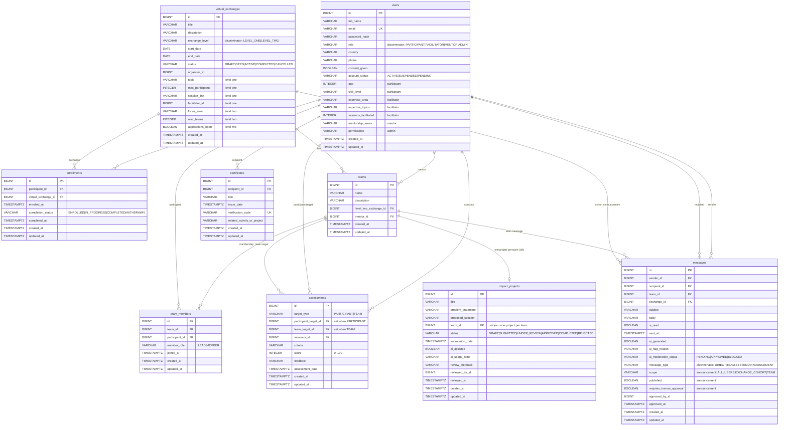

# YEP - Entity Relationship Diagram

Source of truth: `backend/src/main/resources/db/migration/V1__init_schema.sql`
(applied by Flyway in the `prod` profile, and by `test` in CI).

## Notes

1. **Three `SINGLE_TABLE` hierarchies** are stored in one table each, with the JPA
   discriminator column (`role`, `exchange_level`, `message_type`) doing double duty:
   - `users` - `Participant`, `Facilitator`, `Mentor`, `Admin`
   - `virtual_exchanges` - `LevelOneExchange` (topic/session columns), `LevelTwoExchange` (focus/team columns)
   - `messages` - direct/team/system rows ignore the announcement-only columns
2. **Polymorphic assessment target** - `assessments` carries both FKs plus a
   `CHECK (ck_assessments_target)` so exactly one is populated, matching the
   `Assessable` interface in the class model.
3. **Certification rules** - `impact_projects.team_id` is unique (one project per team)
   and `certificates.verification_code` is unique, which powers the public
   `GET /api/v1/certificates/verify/{code}` endpoint.
4. **Indexes** are declared for every join column, every enum used in filters
   (`role`, `account_status`, `exchange_level`, `status`, `completion_status`,
   `message_type`) and the ordering columns used by list endpoints
   (`created_at`, `start_date`, `issue_date`).
5. **Audit columns** - every table has `created_at`; `updated_at` is maintained by
   `BaseEntity` in JPA.
