# YEP - UML Class Diagram

The domain model lives in `backend/src/main/java/com/yep/domain`. It is built around the four OOP
pillars; the mapping table below the diagram points to the exact classes.

```mermaid
classDiagram
    direction TB

    class User {
        <<abstract>>
        -Long userId
        -String name
        -String email
        -String password
        -AccountStatus status
        -Role role
        -String phone
        -OffsetDateTime createdAt
        -OffsetDateTime lastLoginAt
        +register() void
        +login() void
        +logout() void
        +isActive() boolean
        +isPending() boolean
        +isSuspended() boolean
        +getAuthorities() Collection~GrantedAuthority~
    }

    class YouthParticipant {
        -Integer age
        -String country
        -String digitalSkills
        -boolean levelTwoEligible
        -String institution
        -String bio
        -boolean shareProfileWithPartners
        -OffsetDateTime consentDate
    }

    class Facilitator {
        -String specialisation
    }

    class Mentor {
        -String organisation
        -String expertise
    }

    class PartnerOrganisation {
        -String organisationName
        -String country
        -OrganisationType organisationType
        -String website
        -String description
        -boolean verified
    }

    class Administrator {
        -String department
    }

    class LearningActivity {
        <<abstract>>
        -Long activityId
        -Facilitator facilitator
        -PartnerOrganisation partner
        -String title
        -String description
        -LocalDate startDate
        -LocalDate endDate
        -String category
        -Integer capacity
        -ActivityStatus status
        -int passMark
        -int minAttendancePercent
        -int minTeamSize
        -int maxTeamSize
        +getLevelFeatures() List~String~*
        +supportsTeamFormation() boolean*
        +getLevel() ActivityLevel*
        +isPublished() boolean
        +hasCapacity(int) boolean
    }

    class LevelOneActivity {
        +getLevelFeatures() List~String~
        +supportsTeamFormation() boolean
        +conductGroupLearning() String
        +facilitateDiscussion() DiscussionThread
    }

    class LevelTwoActivity {
        +getLevelFeatures() List~String~
        +supportsTeamFormation() boolean
        +formTeams() String
        +developImpactProjects() String
    }

    class Enrollment {
        -Long enrollmentId
        -YouthParticipant youth
        -LearningActivity activity
        -EnrollmentStatus status
        -OffsetDateTime enrollmentDate
        -OffsetDateTime completedAt
        +enroll() void
        +cancel() void
    }

    class VirtualSession {
        -Long sessionId
        -LearningActivity activity
        -String title
        -OffsetDateTime scheduledStart
        -int durationMinutes
        -String meetingLink
        -SessionStatus status
        +openCheckIn() void
        +closeCheckIn() void
    }

    class Attendance {
        -Long attendanceId
        -VirtualSession session
        -YouthParticipant youth
        -AttendanceStatus status
        -OffsetDateTime markedAt
    }

    class LearningMaterial {
        -Long materialId
        -LearningActivity activity
        -String title
        -MaterialType materialType
        -String url
        -User uploadedBy
        -boolean published
    }

    class DiscussionThread {
        -Long threadId
        -LearningActivity activity
        -Team team
        -String topic
        -OffsetDateTime createdAt
    }

    class DiscussionPost {
        -Long postId
        -DiscussionThread thread
        -User author
        -String content
        -boolean flagged
        -boolean hidden
    }

    class AssessmentTask {
        -Long taskId
        -LearningActivity activity
        -String title
        -TaskType taskType
        -List~Map~ questions
        -int maxScore
        -OffsetDateTime dueDate
        -boolean published
    }

    class Assessment {
        -Long assessmentId
        -AssessmentTask task
        -YouthParticipant youth
        -Integer score
        -Integer maxScore
        -AssessmentStatus status
        -String feedback
        -User gradedBy
        +evaluate(int, String) void
        +isPass(int) boolean
    }

    class Certificate {
        -Long certificateId
        -String certificateNumber
        -YouthParticipant youth
        -LearningActivity activity
        -ImpactProject project
        -String achievement
        -LocalDate issueDate
        -boolean revoked
        +revoke() void
    }

    class Team {
        -Long teamId
        -LearningActivity activity
        -Mentor mentor
        -User createdBy
        -String teamName
        -TeamStatus status
        +addMember(YouthParticipant, TeamMemberRole) TeamMember
        +removeMember(YouthParticipant) void
        +isLocked() boolean
    }

    class TeamMember {
        -Long memberId
        -Team team
        -YouthParticipant youth
        -TeamMemberRole role
    }

    class ImpactProject {
        -Long projectId
        -Team team
        -String title
        -String description
        -ChallengeArea challengeArea
        -ProjectStatus status
        -boolean aiUsed
        -String aiUsageDeclaration
        -boolean openForSupport
        +submit() void
        +markUnderReview() void
        +requestChanges() void
        +approve() void
        +complete() void
    }

    class Milestone {
        -Long milestoneId
        -ImpactProject project
        -String title
        -LocalDate dueDate
        -MilestoneStatus status
        -OffsetDateTime completedAt
    }

    class ProjectReview {
        -Long reviewId
        -ImpactProject project
        -Mentor mentor
        -ReviewDecision decision
        -String feedback
    }

    class ProjectSupport {
        -Long supportId
        -ImpactProject project
        -PartnerOrganisation partner
        -SupportType supportType
        -String message
        -SupportStatus status
    }

    class Opportunity {
        -Long opportunityId
        -PartnerOrganisation partner
        -String title
        -OpportunityType opportunityType
        -String description
        -String location
        -LocalDate deadline
        -OpportunityStatus status
    }

    class OpportunityInterest {
        -Long interestId
        -Opportunity opportunity
        -YouthParticipant youth
        -String message
    }

    class Notification {
        <<abstract>>
        -Long notificationId
        -User recipient
        -String message
        -OffsetDateTime dateSent
        -boolean read
        -String link
        +getType() NotificationType*
        +send() String*
        +markRead() void
    }

    class InAppNotification {
        +getType() NotificationType
        +send() String
    }

    class EmailNotification {
        +getType() NotificationType
        +send() String
    }

    class SmsNotification {
        +getType() NotificationType
        +send() String
    }

    class SystemSetting {
        -String key
        -String value
        -User updatedBy
        -OffsetDateTime updatedAt
    }

    class AuditLog {
        -Long logId
        -User user
        -String action
        -String entity
        -Long entityId
        -String details
        -OffsetDateTime createdAt
    }

    class PasswordResetToken {
        -Long tokenId
        -User user
        -String tokenHash
        -OffsetDateTime expiresAt
        -boolean used
    }

    User <|-- YouthParticipant
    User <|-- Facilitator
    User <|-- Mentor
    User <|-- PartnerOrganisation
    User <|-- Administrator

    LearningActivity <|-- LevelOneActivity : level ONE
    LearningActivity <|-- LevelTwoActivity : level TWO

    Notification <|-- InAppNotification : type IN_APP
    Notification <|-- EmailNotification : type EMAIL
    Notification <|-- SmsNotification : type SMS

    YouthParticipant "1" <-- "0..*" Enrollment
    LearningActivity "1" <-- "0..*" Enrollment
    LearningActivity "1" <-- "0..*" VirtualSession
    VirtualSession "1" <-- "0..*" Attendance
    YouthParticipant "1" <-- "0..*" Attendance
    LearningActivity "1" <-- "0..*" LearningMaterial
    LearningActivity "1" <-- "0..*" DiscussionThread
    Team "0..1" <-- "0..*" DiscussionThread
    DiscussionThread "1" <-- "0..*" DiscussionPost
    User "1" <-- "0..*" DiscussionPost

    LearningActivity "1" <-- "0..*" AssessmentTask
    AssessmentTask "1" <-- "0..*" Assessment
    YouthParticipant "1" <-- "0..*" Assessment
    User "0..1" <-- "0..*" Assessment : gradedBy

    YouthParticipant "1" <-- "0..*" Certificate
    LearningActivity "0..1" <-- "0..*" Certificate
    ImpactProject "0..1" <-- "0..*" Certificate

    LearningActivity "1" <-- "0..*" Team
    Mentor "0..1" <-- "0..*" Team
    Team "1" <-- "1..*" TeamMember
    YouthParticipant "1" <-- "0..*" TeamMember
    Team "1" <-- "0..1" ImpactProject
    ImpactProject "1" <-- "0..*" Milestone
    ImpactProject "1" <-- "0..*" ProjectReview
    Mentor "1" <-- "0..*" ProjectReview
    ImpactProject "1" <-- "0..*" ProjectSupport
    PartnerOrganisation "1" <-- "0..*" ProjectSupport

    PartnerOrganisation "1" <-- "0..*" Opportunity
    Opportunity "1" <-- "0..*" OpportunityInterest
    YouthParticipant "1" <-- "0..*" OpportunityInterest

    User "1" <-- "0..*" Notification
    User "0..1" <-- "0..*" AuditLog
    User "1" <-- "0..*" PasswordResetToken
    User "0..1" <-- "0..*" SystemSetting
```

## How the four pillars show up in the code

| Pillar | Where it is applied |
|---|---|
| **Encapsulation** | Entity fields are private; state transitions are methods (`User.register()`, `LearningActivity.hasCapacity()`, `Assessment.evaluate()`, `Notification.markRead()`, `Certificate.revoke()`). DTOs expose only the fields the API needs. |
| **Inheritance** | `User` is a JOINED hierarchy over `users` plus five profile tables. `LearningActivity` is a SINGLE_TABLE hierarchy over `learning_activity` with discriminator `level`. `Notification` is a SINGLE_TABLE hierarchy over `notification` with discriminator `type`. |
| **Polymorphism** | `LearningActivity.getLevelFeatures()` and `supportsTeamFormation()` differ by level. `Notification.send()` and `getType()` differ by channel. `User.register()` applies the correct account status for each role. |
| **Abstraction** | Services depend on repositories and abstract roots rather than concrete subclasses. `SecurityConfig` and the JWT filter hide authentication details. DTO records hide entities from the REST layer. |

## Design notes

- **No Lombok**: entities have explicit fields, constructors, getters and setters; DTOs are Java
  records.
- **JOINED users**: `youth_participant`, `facilitator`, `mentor`, `partner_organisation` and
  `administrator` share `users.user_id` as both primary key and foreign key.
- **Activity level** is both the JPA discriminator and business data, so the API can return
  `level` without loading a subtype.
- **Notification channels** are polymorphic but the default implementation is in-app; email and
  SMS senders are present and can be wired to SMTP/Africa's Talking credentials.
- **Invariants live in the domain and services**: capacity/waitlist rules in `ActivityService`,
  team-size and lock rules in `TeamService`, project submission/review rules in `ProjectService`,
  certificate thresholds in `CertificateService`.
