# YEP – Diagram Updates

> This document shows all additions made to the original class diagram and ER diagram.
> Every class, field, and relationship shown here supplements the diagrams submitted with the project.

---

## Updated Class Diagram (Mermaid)

```mermaid
classDiagram
    class User {
        <<abstract>>
        +Long userId
        +String name
        +String email
        +String password
        +Role role
        +String phone
        +AccountStatus status
        +OffsetDateTime createdAt
        +OffsetDateTime lastLoginAt
        +register()
        +login()
        +logout()
    }

    class YouthParticipant {
        +int age
        +String country
        +String digitalSkills
        +String institution
        +String bio
        +boolean levelTwoEligible
        +boolean shareProfileWithPartners
        +OffsetDateTime consentDate
        +enrollActivity()
        +joinTeam()
        +viewProgress()
    }

    class Facilitator {
        +String specialisation
        +manageActivity()
        +guideParticipants()
        +assessProgress()
    }

    class Mentor {
        +String organisation
        +String expertise
        +mentorTeam()
        +provideFeedback()
    }

    class Administrator {
        +String department
        +manageUsers()
        +managePlatform()
        +generateReports()
    }

    class PartnerOrganisation {
        +String organisationName
        +String country
        +OrganisationType organisationType
        +String website
        +String description
        +boolean verified
        +supportActivities()
        +provideOpportunities()
    }

    User <|-- YouthParticipant
    User <|-- Facilitator
    User <|-- Mentor
    User <|-- Administrator
    User <|-- PartnerOrganisation

    class LearningActivity {
        <<abstract>>
        +Long activityId
        +String title
        +String description
        +LocalDate startDate
        +LocalDate endDate
        +String category
        +ActivityLevel level
        +ActivityStatus status
        +Integer capacity
        +int passMark
        +int minAttendancePercent
        +int minTeamSize
        +int maxTeamSize
        +getLevelFeatures()
        +supportsTeamFormation()
    }

    class LevelOneActivity {
        +conductGroupLearning()
        +facilitateDiscussion()
        +supportsTeamFormation() false
    }

    class LevelTwoActivity {
        +formTeams()
        +developImpactProjects()
        +supportsTeamFormation() true
    }

    LearningActivity <|-- LevelOneActivity
    LearningActivity <|-- LevelTwoActivity

    class LearningMaterial {
        +Long materialId
        +String title
        +MaterialType materialType
        +String url
        +String description
        +boolean published
        +OffsetDateTime uploadedAt
    }

    class VirtualSession {
        +Long sessionId
        +String title
        +OffsetDateTime scheduledStart
        +int durationMinutes
        +String meetingLink
        +SessionStatus status
    }

    class Attendance {
        +Long attendanceId
        +AttendanceStatus status
        +OffsetDateTime markedAt
    }

    class AssessmentTask {
        +Long taskId
        +String title
        +TaskType taskType
        +String instructions
        +List questions
        +int maxScore
        +LocalDate dueDate
        +boolean published
    }

    LearningActivity "1" --> "*" LearningMaterial
    LearningActivity "1" --> "*" VirtualSession
    VirtualSession "1" --> "*" Attendance
    LearningActivity "1" --> "*" AssessmentTask

    class Enrollment {
        +Long enrollmentId
        +OffsetDateTime enrollmentDate
        +EnrollmentStatus status
        +OffsetDateTime completedAt
        +confirmEnrollment()
        +cancelEnrollment()
    }

    class Assessment {
        +Long assessmentId
        +double score
        +String feedback
        +OffsetDateTime assessmentDate
        +AssessmentStatus status
        +String submissionText
        +List answers
        +int maxScore
        +Long gradedBy
        +evaluate()
        +provideFeedback()
    }

    class Certificate {
        +Long certificateId
        +String certificateNumber
        +LocalDate issueDate
        +String achievement
        +generateCertificate()
    }

    class Team {
        +Long teamId
        +String teamName
        +TeamStatus status
        +Long createdById
        +addMember()
        +removeMember()
    }

    class TeamMember {
        +Long memberId
        +TeamRole role
        +assignRole()
    }

    Team "1" *-- "*" TeamMember

    class ImpactProject {
        +Long projectId
        +String title
        +String description
        +String challengeArea
        +ProjectStatus status
        +boolean aiUsed
        +String aiUsageDeclaration
        +OffsetDateTime submittedAt
        +boolean openForSupport
        +createProject()
        +updateProject()
        +submitProject()
    }

    class Milestone {
        +Long milestoneId
        +String title
        +LocalDate dueDate
        +MilestoneStatus status
        +OffsetDateTime completedAt
        +updateMilestone()
    }

    ImpactProject "1" *-- "*" Milestone

    class ProjectReview {
        +Long reviewId
        +ReviewDecision decision
        +String feedback
        +OffsetDateTime createdAt
    }

    class ProjectSupport {
        +Long supportId
        +SupportType supportType
        +String message
        +SupportStatus status
    }

    class Opportunity {
        +Long opportunityId
        +String title
        +OpportunityType opportunityType
        +String description
        +String location
        +LocalDate deadline
        +OpportunityStatus status
    }

    class DiscussionThread {
        +Long threadId
        +String topic
        +OffsetDateTime createdAt
        +createThread()
    }

    class DiscussionPost {
        +Long postId
        +String content
        +OffsetDateTime postedAt
        +boolean flagged
        +String flagReason
        +boolean hidden
        +publishPost()
        +editPost()
    }

    DiscussionThread "1" *-- "*" DiscussionPost
    DiscussionPost --> User : author

    class Notification {
        <<abstract>>
        +Long notificationId
        +String message
        +OffsetDateTime dateSent
        +String link
        +boolean isRead
        +NotificationType type
        +send()
    }

    class EmailNotification {
        +send()
    }

    class InAppNotification {
        +send()
    }

    class SmsNotification {
        +send()
    }

    Notification <|-- EmailNotification
    Notification <|-- InAppNotification
    Notification <|-- SmsNotification
    Notification --> User : recipient

    class NotificationFactory {
        <<factory>>
        +create(type, recipient, message, link) Notification
    }

    class TeamFormationStrategy {
        <<interface>>
        +formTeams(unassigned, activity) List~Team~
    }

    class BalancedTeamStrategy {
        +formTeams(unassigned, activity) List~Team~
    }

    TeamFormationStrategy <|.. BalancedTeamStrategy

    class CertificateIssuer {
        <<interface>>
        +issueCertificate(youth, activity, achievement) Certificate
        +isEligible(youth, activity) boolean
    }

    class NotificationSender {
        <<interface>>
        +deliver(recipient, subject, body)
        +isAvailable() boolean
    }
```



---

## Updated ER Diagram (Mermaid)

```mermaid
erDiagram
    users {
        bigint user_id PK
        varchar name
        varchar email UK
        varchar password_hash
        varchar status
        varchar role
        varchar phone
        timestamp created_at
        timestamp last_login_at
    }

    youth_participant {
        bigint youth_id PK_FK
        int age
        varchar country
        varchar digital_skills
        varchar institution
        text bio
        boolean level_two_eligible
        boolean share_profile_with_partners
        timestamp consent_date
    }

    facilitator {
        bigint facilitator_id PK_FK
        varchar specialisation
    }

    mentor {
        bigint mentor_id PK_FK
        varchar organisation
        varchar expertise
    }

    administrator {
        bigint admin_id PK_FK
        varchar department
    }

    partner_organisation {
        bigint partner_id PK_FK
        varchar organisation_name
        varchar country
        varchar organisation_type
        varchar website
        text description
        boolean verified
    }

    learning_activity {
        bigint activity_id PK
        bigint facilitator_id FK
        bigint partner_id FK
        varchar title
        text description
        date start_date
        date end_date
        varchar category
        varchar level
        varchar status
        int capacity
        int pass_mark
        int min_attendance_percent
        int min_team_size
        int max_team_size
    }

    learning_material {
        bigint material_id PK
        bigint activity_id FK
        varchar title
        varchar material_type
        varchar url
        text description
        bigint uploaded_by FK
        timestamp uploaded_at
        boolean published
    }

    virtual_session {
        bigint session_id PK
        bigint activity_id FK
        varchar title
        timestamp scheduled_start
        int duration_minutes
        varchar meeting_link
        varchar status
        bigint created_by FK
    }

    attendance {
        bigint attendance_id PK
        bigint session_id FK
        bigint youth_id FK
        varchar status
        timestamp marked_at
    }

    assessment_task {
        bigint task_id PK
        bigint activity_id FK
        varchar title
        varchar task_type
        text instructions
        jsonb questions
        int max_score
        date due_date
        boolean published
    }

    enrollment {
        bigint enrollment_id PK
        bigint youth_id FK
        bigint activity_id FK
        timestamp enrollment_date
        varchar status
        timestamp completed_at
    }

    assessment {
        bigint assessment_id PK
        bigint task_id FK
        bigint youth_id FK
        decimal score
        text feedback
        timestamp assessment_date
        text submission_text
        jsonb answers
        int max_score
        varchar status
        bigint graded_by FK
    }

    certificate {
        bigint certificate_id PK
        bigint youth_id FK
        varchar certificate_number UK
        date issue_date
        varchar achievement
    }

    team {
        bigint team_id PK
        bigint mentor_id FK
        bigint activity_id FK
        varchar team_name
        bigint created_by FK
        varchar status
    }

    team_member {
        bigint member_id PK
        bigint team_id FK
        bigint youth_id FK
        varchar role
    }

    impact_project {
        bigint project_id PK
        bigint team_id FK
        varchar title
        text description
        varchar challenge_area
        varchar status
        boolean ai_used
        text ai_usage_declaration
        timestamp submitted_at
        boolean open_for_support
    }

    milestone {
        bigint milestone_id PK
        bigint project_id FK
        varchar title
        date due_date
        varchar status
        timestamp completed_at
    }

    project_review {
        bigint review_id PK
        bigint project_id FK
        bigint mentor_id FK
        varchar decision
        text feedback
        timestamp created_at
    }

    project_support {
        bigint support_id PK
        bigint project_id FK
        bigint partner_id FK
        varchar support_type
        text message
        varchar status
        timestamp created_at
    }

    opportunity {
        bigint opportunity_id PK
        bigint partner_id FK
        varchar title
        varchar opportunity_type
        text description
        varchar location
        date deadline
        varchar status
        timestamp created_at
    }

    discussion_thread {
        bigint thread_id PK
        bigint activity_id FK
        bigint team_id FK
        varchar topic
        timestamp created_at
    }

    discussion_post {
        bigint post_id PK
        bigint thread_id FK
        bigint user_id FK
        text content
        timestamp posted_at
        boolean flagged
        varchar flag_reason
        boolean hidden
    }

    notification {
        bigint notification_id PK
        bigint user_id FK
        text message
        timestamp date_sent
        varchar type
        boolean is_read
        varchar link
    }

    audit_log {
        bigint log_id PK
        bigint user_id FK
        varchar action
        varchar entity
        bigint entity_id
        text details
        timestamp created_at
    }

    system_setting {
        varchar setting_key PK
        text setting_value
        bigint updated_by FK
        timestamp updated_at
    }

    password_reset_token {
        bigint token_id PK
        bigint user_id FK
        varchar token_hash
        timestamp expires_at
        boolean used
    }

    users ||--o{ youth_participant : "is a"
    users ||--o{ facilitator : "is a"
    users ||--o{ mentor : "is a"
    users ||--o{ administrator : "is a"
    users ||--o{ partner_organisation : "is a"
    facilitator ||--o{ learning_activity : "facilitates"
    partner_organisation ||--o{ learning_activity : "sponsors"
    learning_activity ||--o{ learning_material : "has"
    learning_activity ||--o{ virtual_session : "holds"
    learning_activity ||--o{ assessment_task : "has"
    learning_activity ||--o{ enrollment : "enrolls into"
    learning_activity ||--o{ discussion_thread : "has"
    learning_activity ||--o{ team : "contains"
    virtual_session ||--o{ attendance : "records"
    youth_participant ||--o{ enrollment : "makes"
    youth_participant ||--o{ assessment : "submits"
    youth_participant ||--o{ attendance : "attends"
    youth_participant ||--o{ certificate : "earns"
    youth_participant ||--o{ team_member : "joins as"
    assessment_task ||--o{ assessment : "assessed by"
    team ||--o{ team_member : "has"
    team ||--|| impact_project : "owns"
    mentor ||--o{ team : "mentors"
    impact_project ||--o{ milestone : "tracks"
    impact_project ||--o{ project_review : "reviewed by"
    impact_project ||--o{ project_support : "supported by"
    mentor ||--o{ project_review : "writes"
    partner_organisation ||--o{ project_support : "offers"
    partner_organisation ||--o{ opportunity : "posts"
    discussion_thread ||--o{ discussion_post : "contains"
    team ||--o{ discussion_thread : "private"
    users ||--o{ notification : "receives"
    users ||--o{ audit_log : "generates"
    users ||--o{ password_reset_token : "has"
```

---

## Summary of Additions vs Original Diagrams

| Entity / Table | Additions |
|---|---|
| `users` | `phone`, `created_at`, `last_login_at` |
| `youth_participant` | `institution`, `bio`, `share_profile_with_partners`, `consent_date` |
| `partner_organisation` | `organisation_type`, `website`, `description`, `verified` |
| `learning_activity` | `end_date`, `capacity`, `status`, `pass_mark`, `min_attendance_percent`, `min_team_size`, `max_team_size` |
| `enrollment` | `completed_at`; status expanded to `APPLIED/ENROLLED/REJECTED/WAITLISTED/COMPLETED/CANCELLED` |
| `assessment` | `task_id FK`, `answers jsonb`, `submission_text`, `max_score`, `status`, `graded_by` |
| `team` | `created_by`, `status` |
| `team_member` | `role` expanded to `LEADER/MEMBER` |
| `impact_project` | `ai_used`, `ai_usage_declaration`, `submitted_at`, `open_for_support`; status expanded |
| `milestone` | `completed_at`; status `PENDING/IN_PROGRESS/DONE` |
| `notification` | `is_read`, `link`; `type IN_APP/EMAIL/SMS` |
| **New** `learning_material` | `material_id`, `activity_id`, `title`, `material_type`, `url`, `description`, `uploaded_by`, `uploaded_at`, `published` |
| **New** `virtual_session` | `session_id`, `activity_id`, `title`, `scheduled_start`, `duration_minutes`, `meeting_link`, `status`, `created_by` |
| **New** `attendance` | `attendance_id`, `session_id`, `youth_id`, `status`, `marked_at` |
| **New** `assessment_task` | `task_id`, `activity_id`, `title`, `task_type`, `instructions`, `questions jsonb`, `max_score`, `due_date`, `published` |
| **New** `project_review` | `review_id`, `project_id`, `mentor_id`, `decision`, `feedback`, `created_at` |
| **New** `project_support` | `support_id`, `project_id`, `partner_id`, `support_type`, `message`, `status`, `created_at` |
| **New** `opportunity` | `opportunity_id`, `partner_id`, `title`, `opportunity_type`, `description`, `location`, `deadline`, `status`, `created_at` |
| **New** `audit_log` | `log_id`, `user_id`, `action`, `entity`, `entity_id`, `details`, `created_at` |
| **New** `system_setting` | `setting_key`, `setting_value`, `updated_by`, `updated_at` |
| **New** `password_reset_token` | `token_id`, `user_id`, `token_hash`, `expires_at`, `used` |
